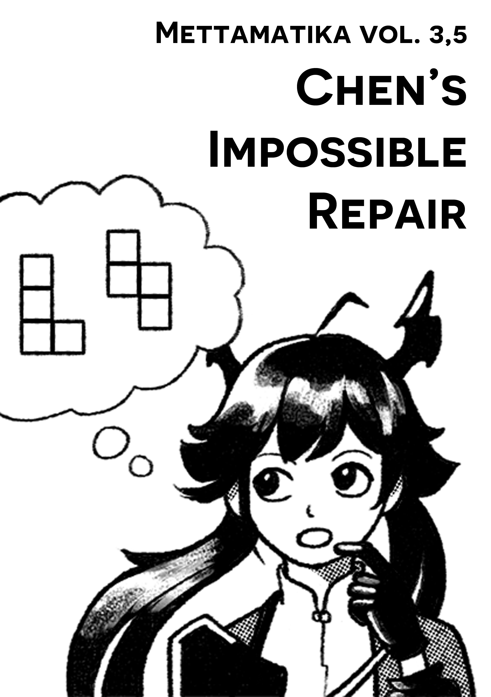
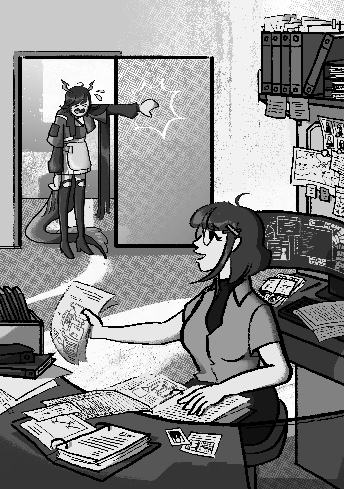
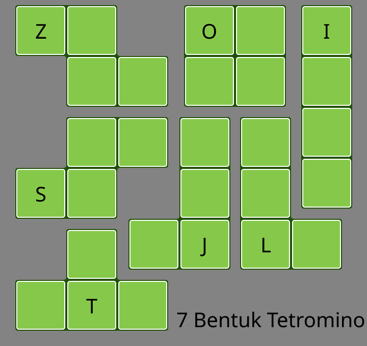
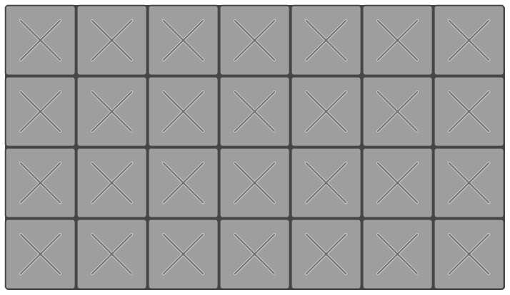
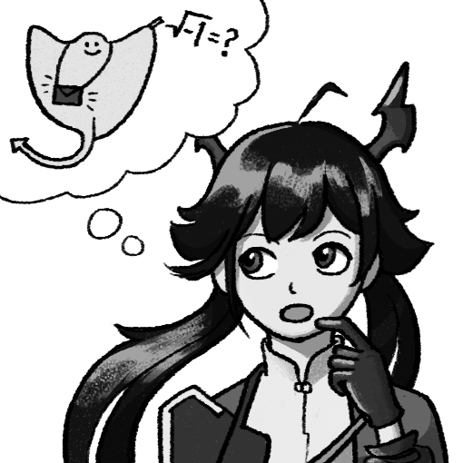
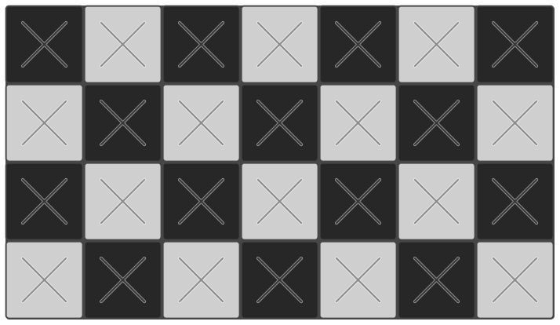
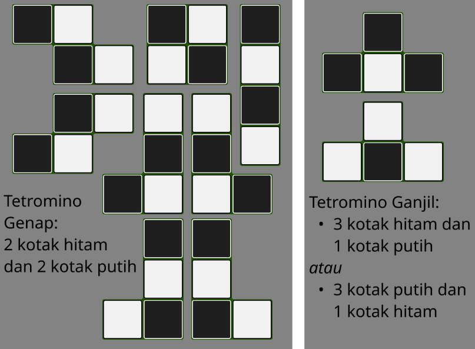
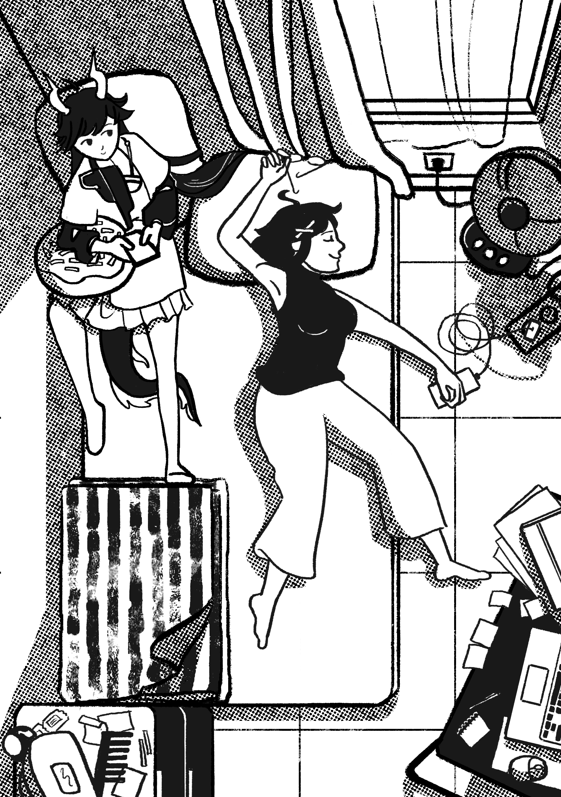

+++
title = "Mettamatika volume 3,5: Chen's Impossible Repair"
date = "2026-10-31"
description = "Mettamatika volume 3,5: Chen's Impossible Repair"
tags = [
    "Mettamatika",
    "Mettamatika vol. 3,5",
    "Mettamatika Paruh"
]
+++

# Intro
Suatu hari, di dalam *game Arknights: Endfield*. Metta sedang berperan sebagai *Endministrator*, manager lapangan dari perusahaan *Endfield Industries*, yang menggunakan teknologi untuk pembangunan planet *Talos-II*.
 

"Endministrator Metta, tolong! *Gue* gak tahan lagi!!"

Seorang gadis naga berekor biru menerobos masuk ke kantor Metta. Keringat bercucuran dari seluruh tubuhnya. Kulitnya kemerahan seperti kepiting rebus.

"Selamat malam Chen. Apakah ada yang bisa dibantu?"

"AC di kamar gue rusak!"

"Coba kita lihat…"

Untuk memperbaiki AC ini, Metta harus menyelesaikan puzzle Originium Repair Circuitry. Untuk menyelesaikan puzzle ini, Metta harus menyusun bentuk-bentuk yang dibuat dari persegi ke dalam sebuah grid.

Tetromino adalah bentuk yang dibangun dari 4 persegi. Mungkin kalian pernah mereka dalam permainan Tetris. Terdapat 7 bentuk tetromino: J, L, S, Z, O, I, dan T. Dalam puzzle ini, kita harus menyusun 7 tetromino tersebut dalam sebuah grid  4 x 7.

 

*Coba, apakah kalian bisa membantu Metta menemukan solusi dari puzzle ini?*
*Kalian bisa mencoba bermain dengan pensil di grid di bawah ini. Untuk bermain tanpa pensil, kalian bisa coba versi digital yang ada di (https://rubicoded.itch.io/metmat-mino)*
 

# Paritas
"Chen, puzzle ini tidak mungkin diselesaikan." 
"Hah, kenapa gak mungkin? *Lu* beneran sudah mencoba semua posisi?"
"Beneran gak mungkin Chen, bisa aku buktikan dengan konsep matematika bernama paritas. "
Raut muka Chen mulai kebingungan. *Paritas? Apaan tuh? Ikan Pari pakai tas? Tunggu, gue mikirin apa sih? Ini kan matematika pembuktian, pasti rumus-rumus kusut kaya mie ayam yang ribet banget… mmm mie ayam…*

 
"Konsep paritas itu sederhana kok, intinya cuma menghitung ganjil-genap saja."

"Serius Met segampang itu? Gue juga bisa kalo cuma ngitung ganjil genap"

"Bagus. Mari kita mulai menghitung ganjil dan genap."
Coba kita warnai grid 4x7 ini dengan pola hitam-putih seperti papan catur. Kita mendapatkan bahwa terdapat 14 kotak hitam (dan 14 kotak putih). 14 adalah bilangan genap.
 

Sekarang, kita warnai semua tetromino dengan pola hitam-putih seperti papan catur juga. Kita akan melihat bahwa ada dua jenis Tetromino:
* Tetromino I, J, L, O, S dan Z semuanya memiliki 2 kotak hitam dan 2 kotak putih. Keenam tetromino ini kita sebut *Tetromino Genap*.
* Sementara Tetromino T bisa memiliki 1 kotak hitam dan 3 kotak putih, atau 3 kotak hitam dan 1 kotak putih. Tetromino T kita sebut *Tetromino Ganjil*.

	 
Misalkan kita menyusun 7 tetromino kita jadi suatu bentuk, lalu kita warnai dengan pola papan catur. Kemudian kita hitung berapa kotak hitam. Karena ada enam Tetromino Ganjil dan satu Tetromino Genap, Hasilnya pasti ganjil, tepatnya 13 atau 15 kotak hitam. Artinya kita tidak mungkin mendapatkan 14 kotak hitam, artinya kita tidak mungkin menyusun mereka dalam grid 4x7. Puzzle ini tidak mungkin diselesaikan.
 
# Solusi
"Gue harus gimana dong Endmin, kalau kita gak bisa benerin AC ini?" 

"Kita bisa menambahkan satu potongan T, dan sekarang kita punya dua Tetromino Ganjil. Kalau kita bisa meletakkan kedua T dengan posisi yang tepat, harusnya puzzle bisa kita selesaikan."

Coba selesaikan puzzle menggunakan dua potongan T. Karena ada potongan berlebih, salah satu dari enam potongan lain tidak perlu digunakan. Untuk bermain tanpa kertas, kalian juga bisa coba click tombol hint dari game.

"Eh Metta, emangnya elu tadi ngambil potongan T dari mana?"

"Ngambil dari AC kamar aku."

"Terus AC kamar lu gimana dong?"

"Aku boleh numpang di kamar Chen aja gak, hehe…"

 
# Epilog
Paritas tampaknya hanyalah konsep dasar yang sederhana, tapi ia sering ditemukan di matematika murni dan terapan yang lebih lanjut. Dalam kombinatorik terdapat permutasi ganjil dan genap, sementara di kalkulus terdapat fungsi ganjil dan genap. Dalam matematika terapan, paritas dapat digunakan komputer untuk algoritma pendeteksi error sederhana.

Dunia Matematika itu luas, jauh lebih luas daripada soal-soal yang kita lihat di sekolah. Kenyataannya tidak semua masalah bisa diselesaikan dengan memasukkan angka ke rumus begitu saja. Terkadang ada masalah atau soal yang tidak punya solusi, dan ada masalah yang perlu pembuktian. Apabila kita sudah mencoba-coba 100 solusi dan gagal, apakah kita boleh menyerah lalu langsung bilang masalah ini tidak mungkin punya solusi? Tidak boleh! Harus ada buktinya. Konsep-konsep logika seperti paritas yang dapat membantu kita membuktikan bahwa sebuah masalah tidak punya solusi.

Mettamatika vol. 3,5

Tim:
* internetofatoms
* Furra
* Rubi
* AuvioraA
* nabnabshaf
* sekarjoget

Mettamatika vol. 3,5 - Chen's Impossible Repair

Text: Rubi

Illustration & Cover: sekarjoget

Spearhead Circle @ L-26/27 Comic Frontier 23