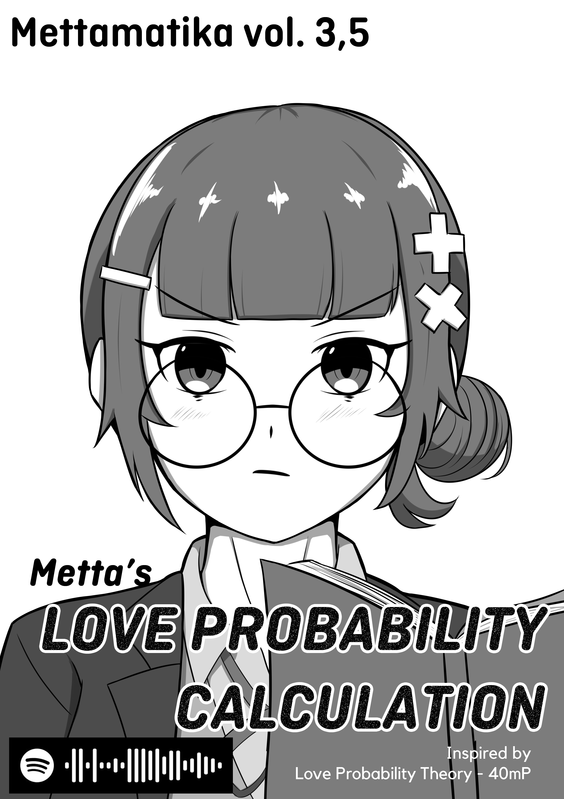
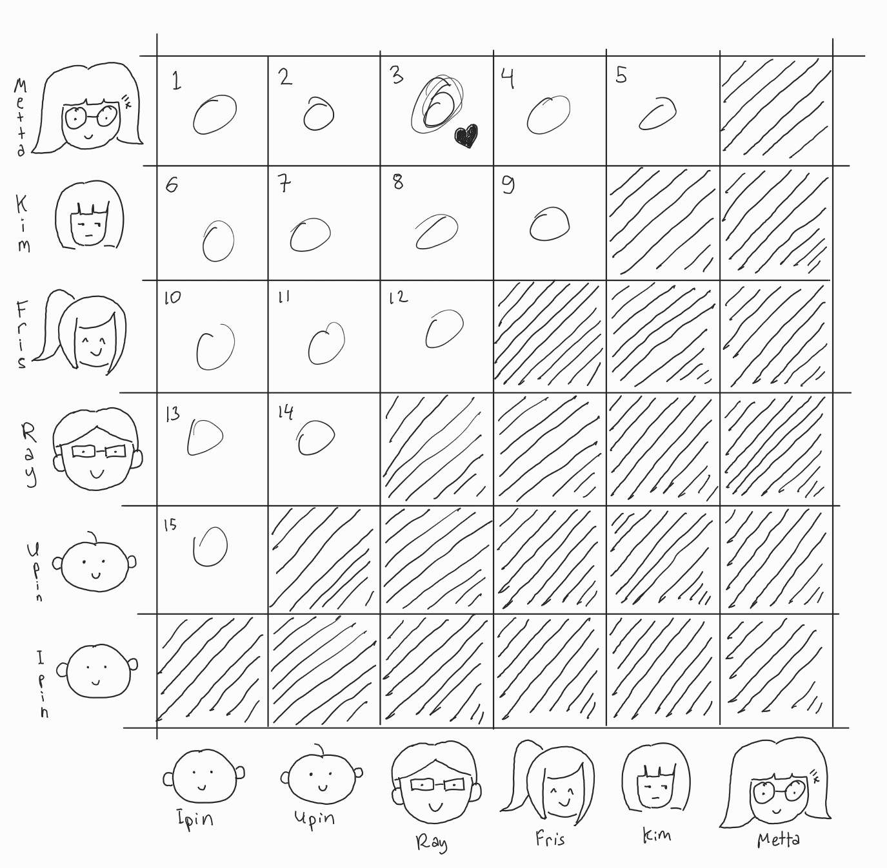
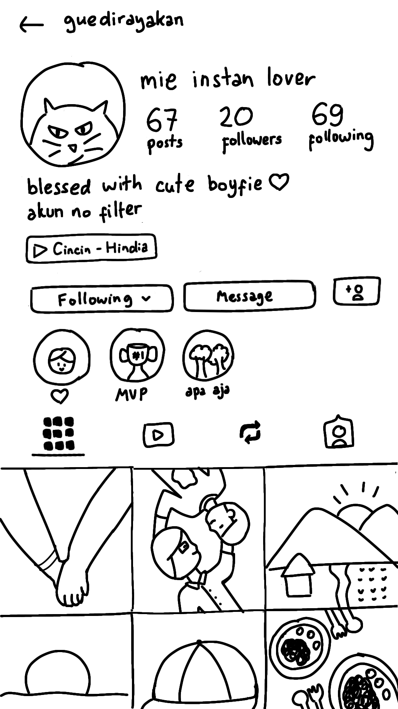

+++
title = "Mettamatika volume 3,5: Metta's Love Probability Calculation"
date = "2026-10-31"
description = "Mettamatika volume 3,5: Metta's Love Probability Calculation"
tags = [
    "Mettamatika",
    "Mettamatika vol. 3,5",
    "Mettamatika Paruh"
]
+++

# Undian Bangku Kelas

今日にすべてを賭けてみる
席替えが行われる日
クジ引きで決まる運命
隣になりますように…
*"Aku mempertaruhkan segalanya hari ini*
*Hari ketika tempat duduk kami diacak*
*Takdir yang ditentukan undian*
*Semoga aku bisa duduk sebelah dia…"*

*'Sekelas ada 31 orang… berarti kemungkinan aku bisa sebelahan sama dia…'* Metta bergumam seraya mencoret-coret kertas catatannya.

"Oke, Ray, kamu duduknya di pojok sebelah jendela ya," Bu Guru mengumumkan hasilnya, ternyata dia yang dapat undian pertama.

"Anjay, pojok sebelah jendela, MC anime banget tuh," ujar teman sebelahnya, Ipin.

"Hehe.." Ray hanya dapat terkekeh kecil.

*'Oke, berarti, karena cuma satu orang yang bisa di sebelah dia dan jumlah orang yang mungkin adalah 30 orang... Berarti kemungkinannya 1/30....' *             

ゼロじゃない限りそこにある望み
*'Selama kemungkinannya bukan nol, masih ada harapan!'*

*'Yah.. aku kebagiannya di lorong tengah…'* Metta mengeluh dalam hati. 

*'EH TAPI MASIH ADA HARAPAN, AKU KAN WEEKEND INI MAU JALAN SAMA DOI! Sama yang lain sihh.. TAPI GAPAPA! YANG PENTING SAMA DOI!! Yahhooo~!'* Metta senyum-senyum sendiri membayangkannya.

"Lu kenapa dah senyum-senyum sendiri?" tanya Kimberly, teman dekat Metta. 

*'Ya seenggaknya sebelahan sama Kimberly deh aku, masih hoki lah ya'*

"Ntar deh aku cerita pas kita *sleepover* hehe"

"Cih, masih lama dong, ya udah deh, awas lu kalo lupa" Kimberly menatap Metta dengan tajam pertanda ancaman.

# Main ke Dufan

Hari yang dinanti pun tiba. Metta, Ray, Kimberly, Friska, (dua orang ini teman dekat Metta), Upin, dan Ipin (dan dua orang ini teman dekatnya Ray). 

"Seneng banget dah lu gua liat-liat, perkara maen ke Dufan doang" ujar Kimberly.

"Hehe iya dong, kan bisa main bareng kalian!" Metta hanya bisa nyengir-nyengir lucu.

Kimberly mengangkat sebelah alisnya, "agak gombal dan mencurigakan ga sih, Fris?" Kimberly terdengar sedikit skeptis.

"Menurut Friska biasa aja sih, soalnya Friska juga senang main sama kalian semua!" Friska tersenyum lebar.

"Argh, salah emang gua nanya sama lu."

Setelah mencoba berbagai wahana, akhirnya sampailah mereka di rumah hantu. Tapi, karena sudah hampir jam tutup, yang bisa masuk hanya dua orang. Akhirnya mereka mengundi pasangan dengan menggunakan 6 permen: 4 warna hijau, 2 warna merah. Tentu saja yang masuk ke rumah hantu yang dapat warna merah. *'Aduh, semoga aku bisa masuk rumah hantu bareng doi..'*

友達と来た遊園地
私と彼と あと4人
お化け屋敷は2人だけ
さあ キャンディーでクジ引き
*'Pergi ke taman rekreasi bersama teman-teman*
*Aku, dia, dan 4 orang lainnya*
*Rumah hantu cuma untuk dua orang*
*Ayo kita undi dengan permen!'*

*'Jadi coba kita buat kotak 6x6 mewakili semua kombinasi pasangan… yang pasangan sama diri sendiri yang di diagonalnya dicoret, soalnya ga mungkin kan pasangan sama diri sendiri…'*

*'Terus, karena urutan pasangan ga ngaruh (A pasangan sama B sama dengan B pasangan sama A), setengahnya aku coret… jadi total kemungkinannya 15.. Lalu, karena yang diinginkan cuma aku sama doi, jadi satu dari total.. 1/15!*

*'Oke, berarti kemungkinan aku bareng doi 1/15 atau 6.7777%! Kecil sih.. tapi…'*

ゼロじゃない限りそこにある望み

*'Selama kemungkinannya bukan nol, masih ada harapan!'*

Ray pun membuka hasil undiannya, oh, ternyata dia dapat warna merah. 

Sekarang, saatnya giliran Metta.

*'Aduh, aku dapet warna apa ya.. Merah juga please..'*

Metta membuka tangannya, 

"Wah aku hijau…" Metta berusaha menyembunyikan kekecewaannya. 

"Wah, gue warna merah…" Upin menyahut, "maaf ya Ray, jadinya sama gue KAOWKAOW" 

Matahari mulai pergi meninggalkan langit. Meskipun gagal berpasangan sama doi, Metta cukup senang hari ini. Dia bisa bersenang ria bersama teman-teman, melepaskan penat sejenak dari belajar dan tugas-tugas.

# Girls Night Out!
Seperti yang telah dijanjikan sebelumnya, Kimberly dan Friska pun datang ke rumah Metta untuk sleepover atau kalau bahasa mereka sih, Girls Night Out!.

Setelah makan malam dan bersih-bersih akhirnya mereka sudah terduduk di atas kasur bersiap-siap tidur. Ya teorinya begitu sih, cuma kan, ini Girls Night Out, ya kali langsung tidur!

"Lantas, apa yang terjadi saudari Metta? Mengapa Metta teman kita ini, terlihat sangat berbunga-bunga? Apa yang terjadi di belakang kita semua, mari kita interogasi yang bersangkutan…" pertanyaan ala-ala presenter gossip dari Kimberly langsung menohok Metta.

"Eh..?" Friska dengan tatapan bingungnya hanya menonton, menunggu respon dari sang narasumber.

"Hehe.. jadi gini gaes.. Aku tuh lagi nge-*crush* orang dari kelas kita…" Metta menjawab namun menghindari kontak mata dengan kedua temannya itu.

"WOW SIAPA GA??" Kimberly dan Friska histeris

"U-uhh.. Itu loh.. *R-Ray..*" Metta agak berbisik ketika menyebutkan namanya

"Oh ya.. Dia lumayan sih…" ujar Kimberly, "tumben selera lu bagus, biasanya kan buluk"

"Waaah..." Friska hanya mangap *excited*.

"HEY KURANG AJAR YA KAMU KIMBERLY! yang kemarin itu khilaf ya, KHI-LAF! Sekarang bener kan selera-"

*TRING*

Di tengah perdebatan mereka, tiba-tiba terdengar suara notifikasi yang mengalihkan perhatian Metta

"AAAAHSDJHAGSD PANJANG UMUR BANGET! INI ORANGNYA DM AKU!! JADHSHJKASHDA" Metta histeris.

"WOWOWOWOWW BUKA BUKA" Kimberly dan Friska ikut semangat

*"Hai Metta, aku izin mutualan sama kamu di second acc IG ku yaa… btw, apapun yang ada di akun itu tolong banget jangan disebar kemana-mana ya, aku percaya kamu, thank you!"*

Lalu, tepat ketika Metta selesai membaca pesannya, muncul notifikasi baru lagi di layar HP Metta:

*guedirayakan has followed you *

"AYO BUKA AKUNNYA MET!"

"Ayo ayo!! Friska penasarann!!"

"Ih.. tapi kan katanya ga boleh disebar kemana-mana…"

Namun, tak lama, di HP Kimberly dan Friska pun muncul notifikasi yang serupa.

"Wah, ternyata kita juga bisa liat nih Met.. hehe.." Kimberly tersenyum iseng.

"Ah iya ya, ternyata dia nganggep kita udah cukup deket ya.." ujar Metta.

"YA UDAH AYO KITA *STALK* AKUNNYA BARENG-BARENGG!!"

"SABAR TUNGGU DIA ACC FOLLOW REQUEST NYA, baru juga aku pencet *follow back* 9 milisekon yang lalu…"

*guedirayakan accepted your follow request*

"Buset langsung banget tuh di-accept."

Akhirnya, mereka semua terfokus pada layar HP Metta. Tampilan profil akun Ray terpampang di layar. 
 

"...JSHDKAS KALO GINI SIH PROBABILITASNYA NOL DONGGG HUAAAA" Tangis Metta sambil menahan tawa ironis.

もうゼロだ。望みはもうない。
*'Ternyata nol, sudah tidak ada harapan'*
****

Mettamatika vol. 3,5

Tim:
* internetofatoms
* Furra
* Rubi
* AuvioraA
* nabnabshaf
* sekarjoget

Mettamatika vol. 3,5 - Metta's Love Probability Calculation

Inspired by Love Probability Theory - 40mP

Text: nabnabshaf

Illustration: AuvioraA

Cover: internetofatoms

Spearhead Circle @ L-26/27 Comic Frontier 23