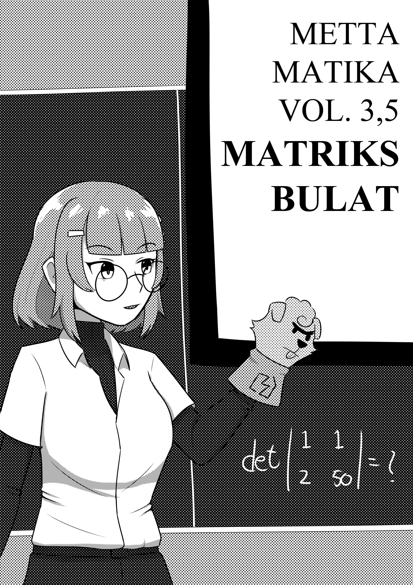
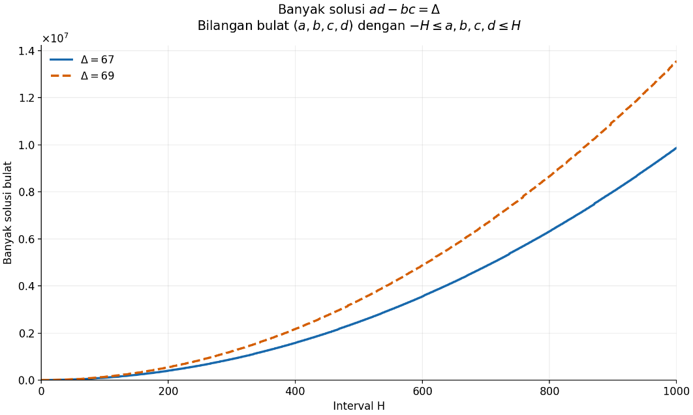

+++
title = "Mettamatika volume 3,5: Matriks Bulat"
date = "2026-10-31"
description = "Mettamatika volume 3,5: Matriks Bulat"
tags = [
    "Mettamatika",
    "Mettamatika vol. 3,5",
    "Mettamatika Paruh"
]
+++

# Intro
Halo, Furra di sini. Jadi puji syukur, saya baru menyelesaikan studi S3 saya di bidang matematika. Lebih tepatnya matematika murni, subbidang teori bilangan. Salah satu pertanyaan yang lazim ditanyakan kepada saya selama S3 adalah "Fur, memangnya elu neliti apaan?" Saya *sih* biasanya tidak menjawab pertanyaan ini secara langsung, kadang *cuman* menjawab "oh matematika murni", atau "oh teori bilangan". Tapi saya hampir *nggak* pernah mendeskripsikan pertanyaan riset saya secara detail kalau ditanya. Kenapa begitu?

Saya sih sebenarnya suka ngiri ngeliat teman-teman yang S3 di teknik dan berkata "oh penelitian saya energi terbarukan," "oh penelitian saya tentang pemanfaatan materi ina inu." Atau teman S3 saya yang lain yang meneliti sel kanker. Atau teman S3 lain yang membahas hukum di Indonesia. Ya, mayoritas topik S3 biasanya berikisar pada objek penelitian mudah dijumpai sehari-hari dan bisa terbayang oleh orang cukup awam [meskipun metode penelitiannya tidak selalu bisa direplikasi orang awam, makanya bisa dipakai untuk S3…]

Lah kalau saya? "Oh, saya meneliti tentang bilangan." Pasti dibalas, "Hah maksudnya gimana? Bikin rumus baru?" "Perlu superkomputer ga?" "Ada ambil datanya ga?" Nasib lah, bidang matematika abstrak pisan. Bahkan menjelaskan objeknya saja perlu kultum tersendiri. Jadi ya biasanya saya menjawab pertanyaan-pertanyaan seperti ini sekenanya, asal penanya cukup mendapatkan gambaran.

Tapi terkadang tidak begitu.

Pertanyaan seperti ini muncul kembali pada saat saya mengikuti forum-forum *networking* antar ilmuwan muda (anjay), utamanya yang lintas bidang seperti, sebutlah, Heidelberg Laureate Forum dan Hong Kong Laureate Forum. Kedua forum ini mempertemukan ilmuwan-ilmuwan muda dari beragam bidang (baca: mahasiswa S1, S2, S3, atau ilmuwan mula-karir) dengan ilmuwan suhu sepuh peraih berbagai penghargaan top matematika, seperti sebutlah Fields Medal, Abel Prize, atau Shaw Prize. Kalau lolos seleksi, peserta terpilih dapat pendanaan hampir-semuanya untuk bisa mengikuti acara-acara ini secara langsung di Heidelberg, Jerman ataupun Hong Kong. 

Nah, forum seperti ini mempertemukan matematikawan muda dengan ilmuwan muda dari bidang lain; ilmu komputer untuk Heidelberg, fisika/astronomi dan biologi/kesehatan untuk Hong Kong.  Utamanya di HKLF, saya diminta untuk mempresentasikan bidang riset saya dalam tiga menit, di hadapan audiens dari beragam subbidang.  Saya berkesempatan mengikuti dua forum ini pada 2025 (dan tentunya saya berterima kasih kepada dua acara ini), dan saya langsung dihadapkan oleh pertanyaan penting: *Bagaimana cara saya menjelaskan riset saya secara 'casual' kepada non-matematikawan?*

Masalahnya ya tadi, boro-boro menjelaskan permasalahan riset saya, saya juga perlu menjelaskan **subbidang** riset saya terlebih dahulu supaya lawan bicara saya dapat memahami permasalahannya.

Permasalahan ini akhirnya memotivasi saya untuk membuat booklet ini sebagai seri Mettamatika 3.5. Dan sedikit catatan sebelum lanjut baca: berbeda dengan seri Mettamatika lain, booklet ini mungkin cenderung memiliki konten lebih matematis (i.e. lebih banyak rumusnya). Semoga menikmati.

# Teori bilangan
Nah, saya dulu menekuni S3 di bidang teori bilangan. Bidang ini sendiri, kalau *copas* dari wikipedia bahasa Indonesia, adalah cabang matematika yang mengkaji bilangan bulat. Saya sebenarnya mau *copas* lebih banyak dari wikipedia, tetapi sayang sekali kualitas terjemahannya masih tergolong sekenanya. Nanti saya sunting *deh* kalau sempat.

Ya secara kasarnya, saya meneliti bilangan bulat. Iya, bilangan 

1,2,3,4,5,6,...

dan seterusnya. Oh, dan bilangan tak positif juga, 0,-1,-2,...,

"Maksudnya bagaimana? Kan ada tak hingga bilangan bulat?"
Tentunya kita tak mengkaji seluruh bilangan bulat secara satu persatu dan eksplisit. Dalam penelitian, yang kita kaji adalah **hubungan** di antara bilangan-bilangan bulat ini. Salah satunya adalah *pemfaktoran* dari bilangan bulat; kasarnya, ya, pemecahan bilangan-bilangan bulat sebagai perkalian bilangan-bilangan bulat lain. Contohnya ya,

$$42 = 6\times7 = 2\times3\times7 $$
$$69 = 3\times23 $$
$$420 = 2\times210 = 2\times2\times105 = 2\times2\times3\times5\times7 $$
$$2026 = 2\times1013$$

Seperti yang kita lihat, pada akhirnya pemfaktoran akan berhenti saat bilangannya tidak dapat dipecah lagi, seperti angka 2, 3, 5, 7, 23, 1013 pada contoh di atas. Bilangan-bilangan seperti ini disebut **bilangan prima**, yang ternyata merupakan fondasi dari seluruh bilangan bulat yang ada. Nah, salah satu kajian utama pada teori bilangan adalah memahami hal-hal yang terkait bilangan prima ini, yang ternyata masih cukup misterius sampai sekarang.

"Kenapa kita perlu tahu tentang bilangan prima ini? Apakah untuk kepo aja?"

Selama ribuan tahun, ya memang *sih*. Hal ini bahkan dibanggakan oleh GH Hardy, salah satu matematikawan teori bilangan tersohor pra-Perang Dunia II, yang mengatakan bahwa "tidak ada yang menemukan kegunaan teori bilangan untuk peperangan, dan sepertinya tidak akan ada selama bertahun-tahun ke depan." Akan tetapi, bertahun-tahun kemudian, ternyata teori bilangan menemukan kegunaannya dalam berbagai sistem kriptografi komputer. Saya sering membayangkan Hardy guling-guling di kuburnya setiap kali kita menggunakan teori bilangan dalam mengenkripsi data di komputer.

Dari cerita ini, kita bisa lihat teori bilangan masuk ke dalam topik penelitian langit-biru (*blue-skies research*) - (baca: topik penelitian yang dimasuki bukan karena kegunaan langsungnya dalam sehari-hari, akan tetapi ya yang berlandaskan ke"kepo"an, rasa ingin tahu alamiah dari manusia). Tapi ya bisa jadi topik dari bidang seperti ini berguna di masa depan, meskipun para penelitinya tidak memikirkan kegunaannya secara langsung pada saat mereka memulai proyeknya.

Ohya sedikit tambahan: di Indonesia, hampir tidak ada dosen yang memiliki topik riset di subbidang ini. Jadi begitulah salah satu alasan utama saya merantau untuk S3 di topik ini. Ya selain karena mendapat beasiswa untuk S3 sih, hehe.

# Matriks dan teori bilangan
Oke, sekarang kita sudah bisa mulai bahas tentang salah satu topik utama dalam penelitian S3 saya: **matriks dan teori bilangan**. Sederhananya, topik penelitian saya mengulik tentang sifat-sifat matriks yang entrinya merupakan bilangan bulat.

Sedikit catatan untuk bagian ini: saya asumsikan kita sudah ngeh mengenai matriks dan vektor. Lebih bagus lagi jika Anda sudah beli Mettamatika volume 3, Matriks dan Vektor, soalnya kami sudah bahas materi ini dengan gaya Mettamatika. Jauh lebih bagus lagi jika Anda juga sudah beli Mettamatika volume 1 dan 2, supaya saya dapat royalti lebih banyak.

Jadi, salah satu pembahasan utama dalam S3 saya adalah matriks dengan entri/'isi' bilangan bulat. Pada penelitian saya, saya meninjau matriks dengan ukuran sekecil dan sebesar mungkin, tapi untuk kepentingan buku ini, kita tinjau saja matriks 2 x 2, sebutlah

$$\begin{bmatrix} 1 & 2 \\ 3 & 4 \end{bmatrix}$$

Kenapa kita perlu mengkaji matriks seperti ini? Kapankah matriks seperti ini muncul di dunia nyata? Salah satu penerapan matriks ini dapat dilihat dalam sistem penyimpanan dan enkripsi data. Kita ingat dulu bahwa komputer menyimpan semua data kita sebagai angka-angka, 0 dan 1. Salah satu sistem enkripsi data yang paling lazim dipakai saat ini, AES, melakukan enkripsi data-data tersebut dengan cara menuliskan data-datanya sebagai matriks 4 x 4, sebutlah 

$$\begin{bmatrix} 
1 & 1 & 0 & 0 \\
0 & 1 & 1 & 0 \\
0 & 0 & 1 & 1 \\
1 & 0 & 0 & 1
 \end{bmatrix}$$

Nantinya, matriks-matriks ini akan mengalami berbagai manipulasi aljabar (seperti penukaran entri, perkalian dengan matriks lain, dan penjumlahan dengan matriks tertentu) selama berbagai ronde agar data yang kita punya dapat dienkripsi dengan aman. Operasi matriks di sini sangat berguna dalam enkripsi dikarenakan algoritma ini gampang untuk dijalankan, tapi sukar untuk dibongkar. Dengan kata lain, data yang kita punya dapat dengan mudah diamankan lewat algoritma matematika ini, tetapi sukar untuk dijebol. Detail lebih lanjut tentang algoritma enkripsi AES dapat dibaca lebih lanjut di luar buku ini.

Kembali ke matriks bilangan bulat, kita panggil kembali matriks

$$\begin{bmatrix} 1 & 2 \\ 3 & 4 \end{bmatrix}$$

Pada latihan awal pelajaran matriks di SMA ataupun kuliah, jika kita diberikan sebuah matriks seperti di atas, ada banyak hal yang bisa kita hitung, contohnya determinan. Untuk kasus 2 x 2, kita cukup 'kali silang' matriksnya dan dapatkan determinan dari matriks ini adalah 

$$1\times4-2\times3=4-6=-2 $$

Salah satu topik penelitian saya saat S3 membahas permasalahan invers dari pertanyaan di atas: *Misalkan kita diberikan sebuah sifat dari matriks, ada berapa banyak matriks yang memenuhi sifat tersebut?*

Sebagai contoh, misalkan kita ingin matriks dengan determinan 67. Contoh paling sederhananya adalah 

$$\begin{bmatrix} 67 & 0 \\ 0 & 1 \end{bmatrix}$$

$$\begin{bmatrix} 1 & 0 \\ 0 & 67 \end{bmatrix}$$

Akan tetapi, tentunya tidak hanya ini saja matriks yang bisa kita temukan. Dua contoh lain:

$$\begin{bmatrix} 23 & 2 \\ 1 & 3 \end{bmatrix}$$

$$\begin{bmatrix} 8 & 3 \\ -1 & 8 \end{bmatrix}$$

Dari sini bisa kita lihat, ada sangat banyak matriks yang memiliki determinan 67, meskipun kita hanya batasi ke matriks 2 x 2. Hal ini dapat dilihat dengan memisalkan entri-entri matriksnya sebagai variabel, sebutlah 

$$\begin{bmatrix} a & b \\ c & d \end{bmatrix}$$

Kalau kita kali silang, kita dapatkan

$$ad-bc=67$$

Ada satu persamaan, tapi ada empat variabel. Secara kasar, kita bisa ambil angka sebarang untuk b dan c, nantinya dua huruf lain bakal 'ngikut'. Sebagai contoh, misalkan b = c = 1, berarti ad = 68. Ada cukup banyak pilihan untuk a dan d, contohnya ya (68,1), (34,2),... dan seterusnya.

Dengan kata lain, ***ada tak hingga*** matriks 2 x 2 yang entrinya bilangan bulat dan memiliki determinan 67.

Tapi ya sebenarnya, angka 67 di sini tidak spesial dan bisa diganti angka lain. Sebutlah 69, 420, 58,... Jawabannya pasti sama; berapapun angka (bulat) yang kita pilih, selalu ada tak hingga matriks 2 x 2 matriks yang entrinya merupakan bilangan bulat.

Akan tetapi, apakah semua ketakhinggaan adalah sama? Maksudnya, kan 67 bilangan prima, sedangkan \(69=3\times23\) "faktornya banyak"? Apakah benar banyak matriks yang memiliki determinan 67 'sama dengan' banyak matriks yang memiliki determinan 69?

Salah satu cara membandingkan dua hal ini adalah memberikan batasan tambahan di setiap entrinya. Sebagai contoh, misalkan kita batasi entrinya di antara -100 dan 100. Kita berarti membandingkan solusi

\(ad-bc=67\) vs \(ad-bc=69\)

dengan syarat \(-100 ≤a,b,c,d ≤ 100\). Untuk menghitung semua solusinya, kita dapat menyerahkan kepada komputer untuk menghitung semua nilai yang mungkin, dan kita dapatkan bahwa ada 98736 solusi saat ∆ =67 dan 135904 solusi saat ∆ =69. Bagaimana kalau 100 kita ganti angka lain? Bisa dilihat lewat tabel berikut (yang dibuat lewat Python):

<table>
    <tr>
        <th></th>
        <th>67</th>
        <th>69</th>
    </tr>
    <tr>
        <th>100</th>
        <th>98736</th>
        <th>135904</th>
    </tr>
    <tr>
        <th>200</th>
        <th>394896</th>
        <th>538368</th>
    </tr>
    <tr>
        <th>300</th>
        <th>888784</th>
        <th>1223744</th>
    </tr>
    <tr>
        <th>400</th>
        <th>1578320</th>
        <th>2170752</th>
    </tr>
    <tr>
        <th>500</th>
        <th>2473488</th>
        <th>3383360</th>
    </tr>
    <tr>
        <th>600</th>
        <th>3550352</th>
        <th>4881728</th>
    </tr>
    <tr>
        <th>700</th>
        <th>4836368</th>
        <th>6638016</th>
    </tr>
    <tr>
        <th>800</th>
        <th>6321232</th>
        <th>8657920</th>
    </tr>
    <tr>
        <th>900</th>
        <th>8005968</th>
        <th>10988416</th>
    </tr>
    <tr>
        <th>1000</th>
        <th>9870544</th>
        <th>13550464</th>
    </tr>
</table>

*terima kasih Val untuk plotnya*

Nah, dari sini kita bisa lihat bagaimana cara membandingkan dua hal yang 'tak berhingga'; batasi saja intervalnya, lalu lihat perilaku grafiknya. Ohya, kita mungkin bisa lihat grafiknya bertingkah seperti parabola, seperti grafik kuadrat lah. Kita akan bahas ini nanti.

Kembali ke balapan antar dua angka ini, tentunya kita bisa ganti 67 dan 69 dengan angka berapapun. Ya sebut saja Delta. Jadi dalam kasus ini, kita tertarik mengamati banyak solusi dari persamaan berikut: 

$$ad-bc=∆$$

Selanjutnya, untuk variabel-variabelnya, saya lebih tertarik untuk melihat apa yang terjadi saat batasnya 'menuju tak hingga'. Jadi kita batasi a,b,c,d atas sebuah parameter, sebutlah H, dan kita ingin tahu besaran solusinya saat H semakin besar dan besar, menuju tak hingga. Secara matematis, kita ingin menghitung banyak solusi \(ad-bc=∆\) dengan a, b, c, d bilangan bulat, \(-H ≤a,b,c,d ≤ H\), dan  \(H→∞\).

Bagaimana cara menyelesaikan permasalahan ini? Pertama, kita perlu mencari dugaan dulu, istilah kerennya 'hipotesis' atau 'heuristik'. Contohnya ya, misalkan b dan c kita tetapkan sebagai bilangan tertentu, anggaplah b = 23, c = 3. Berarti, kita dapatkan \(ad=∆ + 69\), dan a dan d bisa dibilang faktor dari bilangan ini.

Dari observasi ini kita dapatkan, 'kalau b dan c diambil terserah, a dan d bakal *ngikut*'. Akibatnya, persamaan ini akan memiliki 'dua derajat kebebasan'. Dalam bahasa persamaan, karena parameter kita adalah H, nantinya banyak solusi dari \(ad-bc=∆\) dalam interval [-H,H] akan bernilai sekitar \(H^2\). Atau mungkin \(2H^2\), \(3H^2\),..., tapi ya ada kuadrat-kuadratnya *lah*. Hal ini juga dapat diduga dari grafik yang sudah kita lihat, jadinya ya dugaan kita makin kuat.

Nah, salah satu topik riset saya adalah meneliti perilaku dari fungsi ini; dengan kata lain, menentukan perilaku grafiknya saat H menuju tak hingga. Dan jawabannya singkat saja: banyak solusi \(ad-bc=∆\), dengan a, b, c, d bilangan bulat \(-H ≤a,b,c,d ≤ H\),  dan \(H→∞\) , akan mendekati fungsi (dengan kata lain, grafiknya bakal makin mirip)

$$\frac{\sigma(|\Delta|)}{|\Delta|} \cdot \frac{96}{\pi^2}H^2$$

Kak kenapa ada pi? Kenapa ada sigma? Buset banyak amat variabelnya? Saya hanya bisa jawab pertanyaan kedua di buklet ini: \(σ(n)\) adalah jumlah dari seluruh faktor positif n. Sebagai contoh, seluruh faktor 67 hanyalah 1 dan 67, jadi \(σ(67)=1+67=68\), tapi seluruh faktor 69 adalah 1, 3, 23, dan 69, jadi \(σ(69)=1+3+23+69=96\). 

Jadi, banyak solusi dari ad-bc=67 akan mirip dengan \(\frac{67}{68}\cdot\frac{96}{\pi^2}H^2, tetapi banyak solusi dari ad-bc=69 akan mirip dengan \(\frac{96}{69}\cdot\frac{96}{\pi^2}H^2\). Ya bisa diuji dari kalkulator bahwa bilangan terakhir akan lebih besar dari bilangan pertama, seperti yang terlihat di hasil numerik di atas. 

Berarti makin besar angkanya makin banyak solusi? Kalau dibandingkan antara misalkan 67 dan 6767 ya jelas benar, tapi kalau angka Delta-nya kecil belum tentu. Kayak misalkan saat ad-bc=68, dari hasil saya di atas didapat banyak solusinya akan mirip dengan \(\frac{126}{68}\cdot\frac{96}{\pi^2}H^2\), yang lebih besar dari kasus Δ=69. Jadinya ya besar-kecil fungsinya masih bergantung fungsi sigma juga.

Sebagai catatan: hasil penelitian di atas mengatakan bahwa banyak solusinya **mendekati**, bukan sama dengan. Kenapa kita tidak bisa menemukan banyak solusinya secara eksak? Ya biasanya tidak mungkin sih, makanya kita cari solusi yang mendekati saja…

Bagi yang tertarik doksli dari paper ini, silakan merujuk ke:

Afifurrahman, M, A uniform formula on the number of integer matrices with given determinant and height. J. Number Theory 281 (2026), 741–770.
 

# Outro
Ya jadi begitulah usaha saya untuk menjelaskan salah satu pertanyaan riset yang saya lakukan pada saat saya S3. Seberapa lama saya mengerjakan proyek ini? Ya anggap saja berbulan-bulan *lah*, mulai dari cari studi terkait di literatur, menemukan argumentasi yang tepat, dan menyelesaikan persamaan matematika terkait. Dan kemudian menyelesaikan draf awal paper, dilanjutkan dengan penolakan jurnal dan revisi (hadeh).

Apa kegunaan dari penelitian ini? Ya kegunaan utamanya (secara oportunis) adalah membantu saya lulus S3, hahaha. Jawaban lebih serius dapat dibaca di bagian akhir dari bab kedua dari booklet ini [yang bahas blue skies research]. Tapi kegunaan lain dari penelitian ini, masih dalam kacamata agak oportunis: penelitian ini berhasil menghubungkan saya dengan berbagai matematikawan dari seluruh dunia, contohnya ya tim dari India, Amerika Serikat dan Inggris yang ternyata punya proyek yang mirip. Kemudian saya juga mendapat kesempatan mempresentasikan penelitian ini di berbagai negara; sebutlah Australia, Indonesia, Luksemburg, dan Selandia Baru. 

Sekali lagi saya ucapkan terima kasih kepada kedua dosen pembimbing saya selama S3 [bisa dicari sendiri namanya!!!1!] atas bantuan dan bimbingan selama proyek ini. Tentunya saya juga berterima kasih kepada Spearhead Circle dan tim Mettamatika, utamanya ler dan internetofatoms, yang telah membantu pada buku ini. Terakhir, saya ucapkan terima kasih juga kepada kawan-kawan yang telah membaca buklet ini sampai paragraf ini; semoga bermanfaat. Kalau misalkan mau tanya-tanya, kalian tahu lah bisa bertanya lewat mana.

September 2026

Furra (afifurra.github.io)

Ulsan, Korea Selatan.

Mettamatika vol. 3,5

Tim:
* internetofatoms
* Furra
* Rubi
* AuvioraA
* nabnabshaf
* sekarjoget

Mettamatika vol. 3,5 - Matriks Bulat

Text: Furra

Illustration & Cover: internetofatoms

Spearhead Circle @ L-26/27 Comic Frontier 23